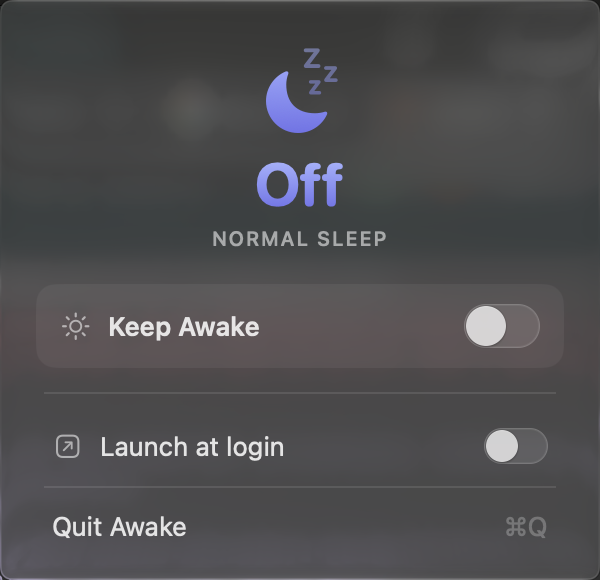
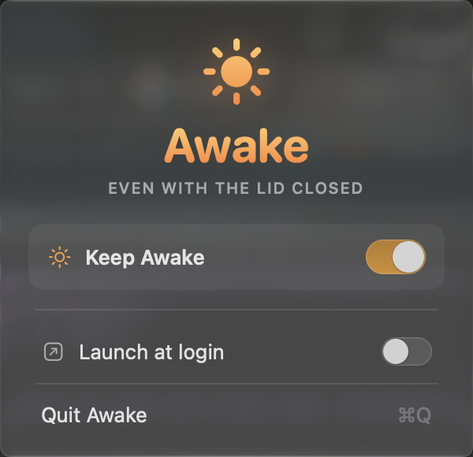

# Awake

A tiny, native macOS menu bar app with one job: keep your Mac awake — even with the
lid closed — behind a single on/off switch. The menu bar tells you the state at a
glance: a zzz-moon while sleep is normal, a filled sun while your Mac is being held
awake (and a warning-badged sun if lid-close blocking isn't set up yet). That's the
whole app.

<p align="center">
  
  
</p>

## How it stays awake (two layers)

Neither mechanism alone does the whole job, so Awake uses both:

1. **Idle sleep** — an [IOKit power assertion](https://developer.apple.com/documentation/iokit)
   (`PreventUserIdleSystemSleep`) stops the idle sleep timer. No privileges needed.
2. **Lid-close sleep** — `pmset disablesleep 1`, run as root via `sudo -n`, stops the Mac
   sleeping when you shut the lid. The assertion can't do this; only pmset can.

Turning the switch off releases the assertion and runs `pmset disablesleep 0`.

If the sudoers rule for layer 2 isn't installed, Awake runs in **degraded** mode: idle
sleep is still blocked, but closing the lid will still sleep — and the app says so, with
a one-time explainer and a "How to fix…" row, rather than silently under-delivering.

## Install

### Download (no build needed)

Grab `Awake.app.zip` from the
[latest release](https://github.com/saltxd/awake/releases/latest), unzip it, and drag
**Awake.app** into `/Applications`. Universal (Apple Silicon + Intel), macOS 14
(Sonoma) or later.

#### First launch — getting past the macOS warning

Awake is open-source and signed ad-hoc (not notarized through Apple's paid Developer
program), so the **first** time you open it macOS warns that it "can't verify it's
free of malware." That's expected for any indie app — here's the one-time,
no-Terminal way past it:

1. Double-click **Awake.app**. macOS blocks it — click **Done**.
2. Open **System Settings → Privacy & Security** and scroll down. You'll see
   *"Awake.app was blocked to protect your Mac."* → click **Open Anyway**.
3. Confirm with **Open Anyway** (Touch ID / password). It launches, and macOS won't
   ask again.

That's it — the moon appears in your menu bar.

<details>
<summary>Prefer the Terminal? One line does the same thing.</summary>

```sh
xattr -dr com.apple.quarantine /Applications/Awake.app && open /Applications/Awake.app
```
</details>

### Build from source

Requires the Swift toolchain. On a stable macOS the Xcode **Command Line Tools** are
enough — no full Xcode needed:

```sh
git clone https://github.com/saltxd/awake.git
cd awake
./build.sh                 # builds + assembles Awake.app
cp -R Awake.app /Applications/
open /Applications/Awake.app
```

> On **beta macOS**, the Command Line Tools can't build SwiftUI app targets. Grab the
> prebuilt `Awake-app` artifact from the latest [CI run](https://github.com/saltxd/awake/actions)
> instead of building locally.

### One-time: enable lid-close blocking

The first time you flip **Keep Awake** on, Awake offers to set this up for you —
click **Enable…**, type your Mac password in the standard macOS prompt, done. (The
panel also has an *Enable lid-close blocking…* row until it's set up.)

Either way — the in-app button or `./install.sh` from a repo checkout — the same
small, **scoped** sudoers rule lands in `/etc/sudoers.d/awake`: exactly two commands
allowed without a password, `pmset disablesleep 1` and `pmset disablesleep 0`, and
nothing else, validated with `visudo -cf` before install. Skip it and the app still
works, just in degraded mode (idle sleep blocked, lid-close not).

## Safety rails

Because this app changes a system-wide sleep setting, undoing it cleanly matters more
than any feature:

- **Launch self-heal** — on every launch Awake runs `pmset disablesleep 0` and starts in
  the off state, so a crash or power-loss that left sleep disabled is corrected next start.
- **Quit restore** — quitting releases the assertion and re-enables normal sleep.
- **Signal handlers** — `SIGTERM`/`SIGINT`/`SIGHUP` restore normal sleep, then exit. A hard
  `SIGKILL` can't be hooked; the launch self-heal covers that case.
- **Idempotent restore** — the teardown is safe to run repeatedly and from any path.

## Verify

```sh
# Idle-sleep assertion held while Keep Awake is on:
pmset -g assertions | grep -i preventuseridlesystemsleep

# Lid-close block (SleepDisabled 1 = blocked, 0 = normal):
pmset -g | grep SleepDisabled
```

## Project layout

| Path | Purpose |
|---|---|
| `Sources/Awake/AwakeApp.swift` | App entry (`MenuBarExtra .window`), lifecycle + signal rails |
| `Sources/Awake/PowerController.swift` | Tri-state machine: IOKit assertion + `sudo -n pmset` |
| `Sources/Awake/AwakePanel.swift` | The menu bar popover UI (hero + Keep Awake switch) |
| `Sources/Awake/MenuBarIcon.swift` | The monochrome menu-bar sun glyph, per state |
| `Sources/Awake/LoginItem.swift` | Launch-at-login toggle (`SMAppService`) |
| `install.sh` | Installs the scoped sudoers rule |
| `build.sh` | Builds + bundles `Awake.app` |

## License

MIT — see [LICENSE](LICENSE).
